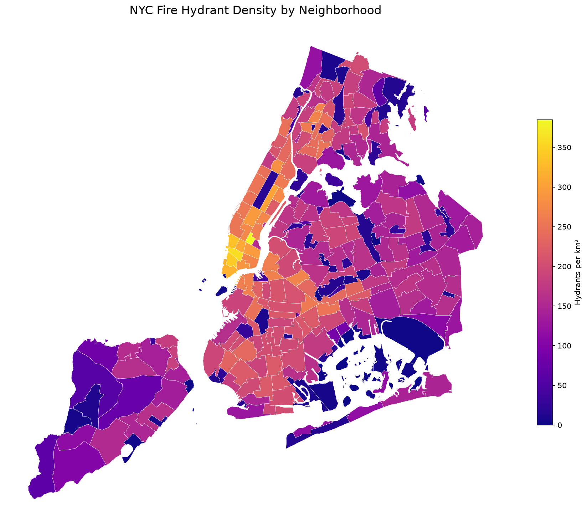

# NYC Hydrant Density Analysis

## The question

Where is hydrant coverage densest in NYC, and which neighborhoods are underserved relative to their area?

## The data

- **NYC Neighborhoods.** 262 polygons (Source: [NYC Open Data](https://opendata.cityofnewyork.us))
- **NYC Fire Hydrants.** 109,725 points (Source: [NYC Open Data](https://opendata.cityofnewyork.us))
- License: NYC Open Data Terms of Use
- All data in EPSG:4326

## Methodology

Built the same analysis twice:

- **SQL (PostGIS).** Five progressive queries in `analysis.sql`, going from simple filter to spatial join to area-normalized density to 100m-buffer coverage analysis.
- **Python (GeoPandas).** Equivalent pipeline in `analysis.ipynb`, with a static choropleth and interactive `.explore()` map. Final output exported to GeoParquet.

Both pipelines produce the same density values to within rounding. The Python version produces the visualization. The SQL version runs against a database at scale.

## Findings

The median neighborhood has **165.51** hydrants per km². The median neighborhood has **95.2%** of its area within 100 meters of a hydrant.

### Top 10 neighborhoods by hydrant count

| Neighborhood | Borough | Hydrants |
|---|---|---:|
| Annadale-Huguenot-Prince's Bay-Woodrow | Staten Island | 1,708 |
| Great Kills-Eltingville | Staten Island | 1,672 |
| Todt Hill-Emerson Hill-Lighthouse Hill-Manor Heights | Staten Island | 1,282 |
| Sheepshead Bay-Manhattan Beach-Gerritsen Beach | Brooklyn | 1,187 |
| Canarsie | Brooklyn | 1,155 |
| Westerleigh-Castleton Corners | Staten Island | 1,137 |
| New Springville-Willowbrook-Bulls Head-Travis | Staten Island | 1,111 |
| West New Brighton-Silver Lake-Grymes Hill | Staten Island | 1,103 |
| Bay Ridge | Brooklyn | 1,096 |
| St. Albans | Queens | 1,086 |

### Top 10 neighborhoods by hydrant density (per km²)

| Neighborhood | Borough | Hydrants | Area (km²) | Hydrants per km² |
|---|---|---:|---:|---:|
| Gramercy | Manhattan | 269 | 0.70 | 384.73 |
| SoHo-Little Italy-Hudson Square | Manhattan | 432 | 1.20 | 360.00 |
| Tribeca-Civic Center | Manhattan | 433 | 1.26 | 343.25 |
| West Village | Manhattan | 447 | 1.34 | 333.74 |
| Financial District-Battery Park City | Manhattan | 570 | 1.79 | 319.11 |
| Greenwich Village | Manhattan | 304 | 0.99 | 308.62 |
| Upper East Side-Carnegie Hill | Manhattan | 565 | 1.86 | 303.09 |
| East Village | Manhattan | 522 | 1.76 | 296.03 |
| Midtown-Times Square | Manhattan | 669 | 2.28 | 293.29 |
| Chinatown-Two Bridges | Manhattan | 310 | 1.07 | 289.12 |

### 10 least covered neighborhoods

Covered share is the fraction of the neighborhood within 100 meters of a hydrant.

| Neighborhood | Borough | Covered share |
|---|---|---:|
| Hoffman & Swinburne Islands | Staten Island | 0.00 |
| Jamaica Bay (West) | Brooklyn | 0.00 |
| Shirley Chisholm State Park | Brooklyn | 0.02 |
| John F. Kennedy International Airport | Queens | 0.04 |
| Fort Totten | Queens | 0.05 |
| LaGuardia Airport | Queens | 0.06 |
| Jamaica Bay (East) | Queens | 0.06 |
| The Battery-Governors Island-Ellis Island-Liberty Island | Manhattan | 0.06 |
| Great Kills Park | Staten Island | 0.09 |
| Fort Wadsworth | Staten Island | 0.10 |



## How to run it

Requires Docker (for PostGIS) and Python 3.11+ with GeoPandas.

```bash
git clone https://github.com/{your-username}/nyc-hydrant-analysis.git
cd nyc-hydrant-analysis

# Start the PostGIS template (copy from R2.4 docker-templates/postgis/)
docker compose -f docker/postgis/docker-compose.yml up -d

# Load NYC Open Data into PostGIS (your script of choice)
# Then run the SQL pipeline
psql -h localhost -U gisuser -d nyc -f analysis.sql

# Then the Python pipeline
jupyter lab analysis.ipynb
```

## What I learned

Python workflow can be more complicated, but usually more accurate with a couple of interaction. 
SQL is faster even in one interaction, but it can be less complicated if you provide a better prompt. 

## Stack

- PostGIS 16-3.4 (via Docker)
- GeoPandas + SQLAlchemy + matplotlib
- Jupyter Lab
- GeoParquet